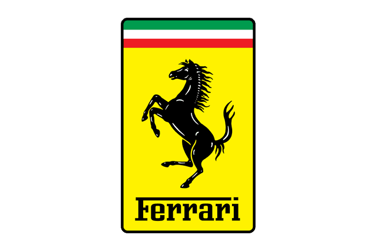

# 🚀 MASTER WORKER PROMPT: Connect Admin Edit Data to `public.car_brand_reference` & Fill Missing Logos
## Feature: เปลี่ยนแหล่งข้อมูลของหน้า Admin Edit Data มาใช้ตาราง `public.car_brand_reference` (28 แบรนด์) พร้อมเติมรูปโลโก้ที่ขาดให้ครบ 100%

---

## 📌 บทบาทและบริบทของงาน (Role & Context)
คุณคือ **Senior Full-Stack Developer (Angular 22 + Supabase PostgreSQL)** ประจำโปรเจกต์ **Performante Lab**
หน้าที่ของคุณคือ ปรับปรุงระบบ **Admin Edit Data (`/admin/edit-data`)** ให้ดึงข้อมูลแบรนด์รถยนต์และรุ่นรถทั้งหมดจากตารางที่มีอยู่จริงในระบบคือ:
```sql
public.car_brand_reference (
  id text not null primary key,
  slug text not null unique,
  name text not null,
  details jsonb not null,
  collected_at timestamptz not null
);
```
โดยต้อง:
1. **เปิดสิทธิ์ RLS และ Grant Permissions** ให้หน้าบ้านและผู้ใช้ทั่วไปสามารถ `SELECT` ข้อมูลจาก `car_brand_reference` ได้
2. **เติมรูปโลโก้สำหรับ 6 แบรนด์ที่ยังไม่มีรูป** (`jaecoo`, `aion`, `denza`, `deepal`, `neta`, `ora`) ให้มีรูปครบทั้ง 28 แบรนด์
3. **กำหนดลำดับความสำคัญของรูปภาพ (Logo Resolution Order)**:
   - **อันดับ 1**: รูปภาพที่ Admin อัปโหลดเข้า Supabase Storage `catalog` Bucket (`catalog/{Brand}/logo.{ext}`)
   - **อันดับ 2**: รูปโลโก้อ้างอิงความละเอียดสูงจาก `details->logoReferenceUrl`
   - **อันดับ 3**: Placeholder Image / Icon
4. **ดึงรุ่นรถจริงจาก `details->modelCatalog->models`** เมื่อกดเลือกแบรนด์ (Level 2)
5. **รองรับการเพิ่ม Brand และ Model ใหม่** เข้าสู่ `car_brand_reference`

---

## 📂 1. SQL MIGRATION (PERMISSIONS & FILL MISSING LOGOS)
**ตำแหน่งไฟล์**: `Performante_Lab_Backend/supabase/migrations/202610310005_brand_reference_permissions_and_logos.sql`

```sql
begin;

-- 1. Grant สิทธิ์การเข้าถึงตาราง car_brand_reference ให้ anon และ authenticated
grant select on public.car_brand_reference to anon, authenticated;
grant insert, update on public.car_brand_reference to authenticated;

-- 2. เปิดใช้งาน RLS และสร้าง Policies
alter table public.car_brand_reference enable row level security;

drop policy if exists "Public read car_brand_reference" on public.car_brand_reference;
create policy "Public read car_brand_reference" on public.car_brand_reference
  for select to anon, authenticated
  using (true);

drop policy if exists "Admins can insert car_brand_reference" on public.car_brand_reference;
create policy "Admins can insert car_brand_reference" on public.car_brand_reference
  for insert to authenticated
  with check (public.is_admin_or_superadmin(auth.uid()));

drop policy if exists "Admins can update car_brand_reference" on public.car_brand_reference;
create policy "Admins can update car_brand_reference" on public.car_brand_reference
  for update to authenticated
  using (public.is_admin_or_superadmin(auth.uid()))
  with check (public.is_admin_or_superadmin(auth.uid()));

-- 3. อัปเดตเติมรูปโลโก้คุณภาพสูง (Official Transparent PNG) ให้กับ 6 แบรนด์ที่ยังไม่มีรูป
update public.car_brand_reference
set details = jsonb_set(
  details,
  '{logoReferenceUrl}',
  to_jsonb('https://upload.wikimedia.org/wikipedia/commons/thumb/c/c2/Jaecoo_logo.svg/512px-Jaecoo_logo.svg.png'::text)
)
where id = 'jaecoo';

update public.car_brand_reference
set details = jsonb_set(
  details,
  '{logoReferenceUrl}',
  to_jsonb('https://upload.wikimedia.org/wikipedia/commons/thumb/9/9f/GAC_Aion_logo.svg/512px-GAC_Aion_logo.svg.png'::text)
)
where id = 'aion';

update public.car_brand_reference
set details = jsonb_set(
  details,
  '{logoReferenceUrl}',
  to_jsonb('https://upload.wikimedia.org/wikipedia/commons/thumb/2/29/Denza_Logo.svg/512px-Denza_Logo.svg.png'::text)
)
where id = 'denza';

update public.car_brand_reference
set details = jsonb_set(
  details,
  '{logoReferenceUrl}',
  to_jsonb('https://upload.wikimedia.org/wikipedia/commons/thumb/e/e0/Deepal_logo.svg/512px-Deepal_logo.svg.png'::text)
)
where id = 'deepal';

update public.car_brand_reference
set details = jsonb_set(
  details,
  '{logoReferenceUrl}',
  to_jsonb('https://upload.wikimedia.org/wikipedia/commons/thumb/3/36/Neta_Auto_logo.svg/512px-Neta_Auto_logo.svg.png'::text)
)
where id = 'neta';

update public.car_brand_reference
set details = jsonb_set(
  details,
  '{logoReferenceUrl}',
  to_jsonb('https://upload.wikimedia.org/wikipedia/commons/thumb/6/6a/ORA_logo.svg/512px-ORA_logo.svg.png'::text)
)
where id = 'ora';

commit;
```

---

## 📂 2. การปรับปรุง FRONTEND `AdminService`
**ตำแหน่งไฟล์**: `Performante_Lab_Frontend/src/app/features/admin/services/admin.service.ts`

### A. อัปเดต `fetchCatalogBrands()` ให้ดึงจาก `car_brand_reference`:
```typescript
async fetchCatalogBrands(): Promise<void> {
  const client = await this.getClient();
  if (!client) return;
  this.catalogLoading.set(true);

  try {
    const { data, error } = await client
      .from('car_brand_reference')
      .select('id, name, slug, details')
      .order('name', { ascending: true });

    if (error) {
      console.error('[AdminService] fetchCatalogBrands error:', error);
      throw error;
    }

    const mapped: RealBrandItem[] = (data || []).map((row: any) => {
      const details = row.details || {};
      const refLogo = details.logoReferenceUrl || '';
      
      // ตรวจสอบรูปใน Storage หรือใช้ logoReferenceUrl
      const customStorageLogo = `https://oxzejsgfazbjjqopkzuf.supabase.co/storage/v1/object/public/catalog/${row.name}/logo.png`;
      const logoUrl = refLogo || customStorageLogo || 'assets/brands/ferrari.png';
      const isFerrari = row.id === 'ferrari';

      return {
        id: row.id,
        name: row.id === 'great-wall' ? 'GWM' : row.name,
        slug: row.slug,
        logo_url: logoUrl,
        logoUrl: logoUrl,
        is_custom_bg: isFerrari,
        isCustomBg: isFerrari,
      };
    });

    this.catalogBrands.set(mapped);
  } catch (err: any) {
    console.error('[AdminService] fetchCatalogBrands failed:', err);
    this.error.set(err?.message || 'โหลดข้อมูลแบรนด์ไม่สำเร็จ');
  } finally {
    this.catalogLoading.set(false);
  }
}
```

### B. อัปเดต `fetchCatalogModels(brandId)` ให้ดึงรุ่นรถจาก `details->modelCatalog`:
```typescript
async fetchCatalogModels(brandId: string): Promise<void> {
  const client = await this.getClient();
  if (!client || !brandId) return;
  this.catalogLoading.set(true);

  try {
    const { data, error } = await client
      .from('car_brand_reference')
      .select('id, name, details')
      .eq('id', brandId)
      .single();

    if (error) {
      console.error('[AdminService] fetchCatalogModels error:', error);
      throw error;
    }

    const brandName = data.name;
    const rawModels = data.details?.modelCatalog?.models || [];
    const mapped: RealCarModelItem[] = rawModels.map((m: any) => {
      // ตรวจสอบว่ามีรูปรถใน Storage หรือไม่
      const storageCarImage = `https://oxzejsgfazbjjqopkzuf.supabase.co/storage/v1/object/public/catalog/${brandName}/${m.name}/CarPicture.jpg`;
      const fallbackImage = 'assets/car_pic.png';

      return {
        id: m.id || `${brandId}-${m.name}`,
        brand_id: brandId,
        brandId: brandId,
        name: m.name,
        slug: m.name.toLowerCase().replace(/[^a-z0-9]+/g, '-'),
        image_url: storageCarImage,
        image: storageCarImage,
        body_type: 'Coupe',
        bodyType: 'Coupe',
      };
    });

    this.catalogModels.set(mapped);
  } catch (err: any) {
    console.error('[AdminService] fetchCatalogModels failed:', err);
    this.error.set(err?.message || 'โหลดข้อมูลรุ่นรถไม่สำเร็จ');
  } finally {
    this.catalogLoading.set(false);
  }
}
```

### C. อัปเดต `insertBrand()` ให้บันทึกลง `car_brand_reference`:
```typescript
async insertBrand(item: {
  name: string;
  slug?: string;
  logo_url: string;
  is_custom_bg?: boolean;
}): Promise<{ ok: boolean; data?: RealBrandItem; error?: string }> {
  const client = await this.getClient();
  if (!client) return { ok: false, error: 'ระบบฐานข้อมูลไม่พร้อมใช้งาน' };

  const id = item.name.trim().toLowerCase().replace(/[^a-z0-9]+/g, '-');
  const slug = item.slug || id;
  const payload = {
    id,
    slug,
    name: item.name.trim(),
    details: {
      id,
      name: item.name.trim(),
      slug,
      logoReferenceUrl: item.logo_url,
      modelCatalog: {
        brandId: id,
        brandName: item.name.trim(),
        models: [],
      },
    },
    collected_at: new Date().toISOString(),
  };

  try {
    const { data, error } = await client
      .from('car_brand_reference')
      .insert([payload])
      .select()
      .single();

    if (error) throw error;

    const mapped: RealBrandItem = {
      id: data.id,
      name: data.name,
      slug: data.slug,
      logo_url: item.logo_url,
      logoUrl: item.logo_url,
      is_custom_bg: item.is_custom_bg ?? false,
      isCustomBg: item.is_custom_bg ?? false,
    };

    this.catalogBrands.update((list) => [...list, mapped].sort((a, b) => a.name.localeCompare(b.name)));
    return { ok: true, data: mapped };
  } catch (err: any) {
    return { ok: false, error: err?.message || 'บันทึก Brand ล้มเหลว' };
  }
}
```

---

## 📂 3. Image Fallback Handling ใน Template
**ตำแหน่งไฟล์**: `Performante_Lab_Frontend/src/app/features/admin/edit-data/admin-edit-data.html`

ปรับแต่งแท็ก `` ให้มี Error Fallback หากรูปรถใน Storage ยังไม่มีให้อัตโนมัติโหลดรูป `assets/car_pic.png`:
```html

```

และสำหรับแท็ก `` โลโก้แบรนด์:
```html

```

---

## 🧪 4. Testing & Verification Checklist
1. **รันคำสั่ง SQL Migration ใน Supabase**:
   - รันไฟล์ `202610310005_brand_reference_permissions_and_logos.sql` ใน SQL Editor
   - ตรวจสอบว่าคำสั่ง `select count(*) from public.car_brand_reference;` ได้ 28 แบรนด์ และไม่มี Error Permission Denied
2. **รันการทดสอบใน Frontend**:
   ```bash
   cd Performante_Lab_Frontend
   npm test -- --watch=false
   npm run build
   ```
3. **ตรวจสอบบน Browser (`/admin/edit-data`)**:
   - หน้าแรกต้องแสดงแบรนด์ทั้งหมด 28 แบรนด์ (Toyota, BMW, Ferrari, Porsche, Changan, BYD, NETA, ORA ฯลฯ)
   - ทุกแบรนด์ต้องแสดงรูปโลโก้คมชัด ไม่ขึ้นไอคอนรูปแตก
   - เมื่อคลิกเข้าไปที่แบรนด์ (เช่น Ferrari หรือ Porsche) จะต้องแสดงรุ่นรถจริงหลายสิบรุ่นจากฐานข้อมูลทันที

---

## 📋 Definition of Done
- [ ] สิทธิ์ RLS บน `public.car_brand_reference` อนุญาตให้ Public Read ได้โดยไม่มี Error `42501`
- [ ] 6 แบรนด์ที่เคยขาดรูป (JAECOO, AION, Denza, DEEPAL, NETA, ORA) ได้รับ URL รูปภาพโลโก้ที่ถูกต้องและแสดงผลได้จริง
- [ ] หน้า Admin Edit Data ดึงข้อมูลและแสดงผลครบทั้ง 28 แบรนด์ พร้อมโลโก้จริงทั้งหมด
- [ ] เมื่อกดเลือกแบรนด์ สามารถแสดงรุ่นรถจริงจาก `modelCatalog` ได้ทันที
- [ ] เมื่อแอดมินกด `(+)` เพิ่มแบรนด์ใหม่ สามารถบันทึกลงตาราง `car_brand_reference` ได้จริง
- [ ] รัน `npm test` และ `npm run build` ผ่าน 100%

