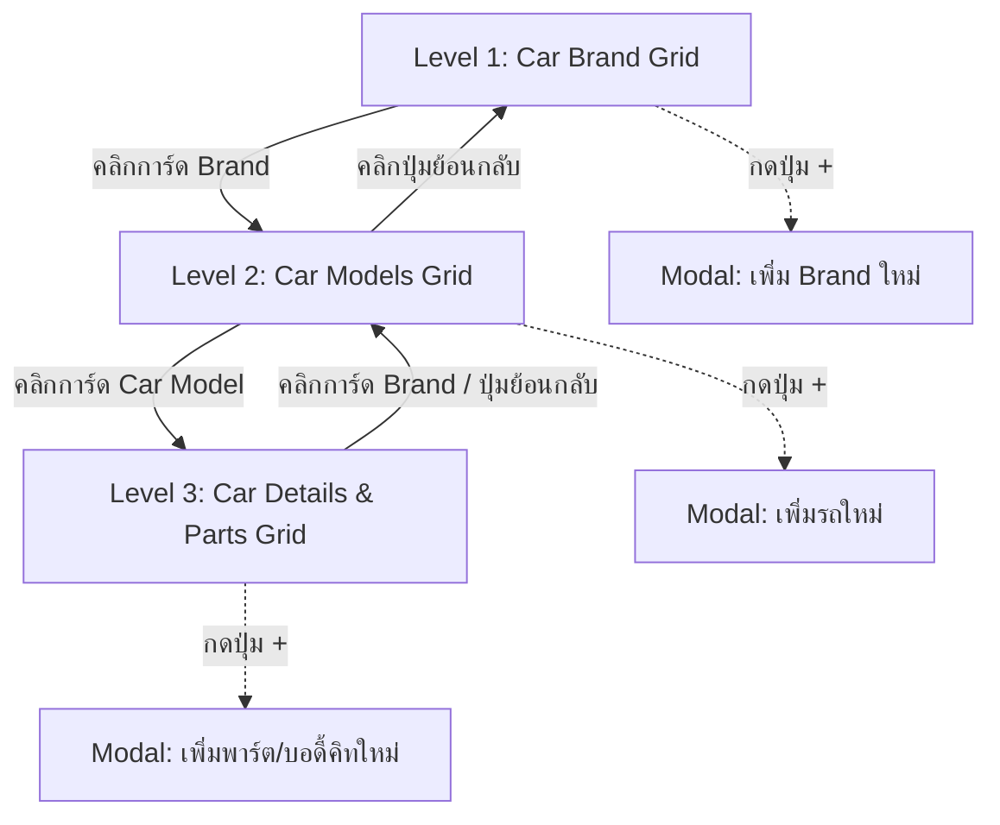

# 🚀 MASTER WORKER PROMPT: Admin Edit Data Portal
## Feature: ระบบจัดการข้อมูลรถ แบรนด์ รุ่น และพาร์ต (Brand -> Car Models -> Car Parts)

---

## 📌 บทบาทและบริบทของงาน (Role & Context)
คุณคือ **Senior Frontend Developer (Angular 22)** ประจำโปรเจกต์ **Performante Lab**
หน้าที่ของคุณคือ พัฒนาหน้าจอ **Admin Edit Data (`/admin/edit-data`)** ใน Admin Portal ตามภาพดีไซน์อ้างอิง:
- `Admin(Edit Data1).png` & `Admin(Edit Data2).png` (หน้า Car brand & เพิ่ม Brand)
- `Admin(Edit Data3).png` (หน้าเลือกรุ่นรถ Car Name & เพิ่มรถใหม่)
- `Admin(Edit Data4).png` (หน้ารายละเอียดรถ & เพิ่มพาร์ต/Full Body Kits)

ระบบทำงานด้วย **View State Navigation (3 ระดับในหน้าเดียว)** จัดการข้อมูลผ่าน Angular Signals ใน `AdminService` พร้อมจำลองบันทึกด้วย `LocalStorage`

---

## 🗺️ โครงสร้างการนำทาง 3 ระดับ (View Hierarchy Flow)



---

## 🎨 รายละเอียดหน้าจอตามภาพดีไซน์ (Visual Specifications)

### 1. Level 1: หน้า Car brand (`Admin(Edit Data1-2).png`)
- **Header**:
  - Title: `Edit Data` (ฟอนต์ Display, ขาว หนา 3xl)
  - Subtitle: `เพิ่ม/ลบ/แก้ไข/อัปเดตข้อมูลรุ่นรถและพาร์ตต่างๆ` (text-stone-400 text-xs)
- **Section Heading**: `Car brand` (text-white font-medium text-sm sm:text-base)
- **Grid Layout**: การ์ดสี่เหลี่ยมจัตุรัส (`aspect-square`), กริด 2 ถึง 6 คอลัมน์ (`grid-cols-2 sm:grid-cols-3 md:grid-cols-4 lg:grid-cols-6 gap-4`)
- **การ์ดใบแรก (ปุ่ม + เพิ่ม Brand)**:
  - พื้นหลังสีเข้ม `#191919`, กรอบ `border border-white/10 hover:border-white/25`
  - มีไอคอน `+` (วงกลมพร้อมเครื่องหมายบวกสีขาว) อยู่ตรงกลาง
  - เมื่อคลิก -> เปิด Modal เพิ่ม Brand รถ
- **การ์ด Brand ต่างๆ**:
  - โลโก้แบรนด์วางตรงกลาง (Toyota, Mercedes-Benz, Ferrari, Honda ฯลฯ)
  - แบรนด์ Ferrari: โดดเด่นด้วยพื้นหลังสีแดง Gradient เข้ม (`bg-gradient-to-b from-[#990000] to-[#ce281a]` หรือกรอบเรืองแสงสีแดง) ตามภาพ
  - เมื่อคลิกการ์ด Brand ใด -> สลับเข้าสู่ **Level 2 (Car Models)** ของแบรนด์นั้น

---

### 2. Level 2: หน้ารายการรุ่นรถ Car Name (`Admin(Edit Data3).png`)
- **Section Heading**: `Car Name`
- **ปุ่มย้อนกลับ / Selected Brand Card (การ์ดใบแรก)**:
  - แสดงการ์ดโลโก้ของ Brand ที่กำลังเลือกอยู่ (เช่น Ferrari การ์ดแดง)
  - ทำหน้าที่เป็น Badge บ่งบอกบริบท และสามารถคลิกเพื่อย้อนกลับไปหน้า Brand (Level 1) ได้
- **การ์ดใบที่สอง (ปุ่ม + เพิ่มรถใหม่)**:
  - การ์ดสี่เหลี่ยมสีเข้ม `#191919` พร้อมไอคอน `+` ตรงกลาง
  - เมื่อคลิก -> เปิด Modal เพิ่มรุ่นรถใหม่ภายใต้แบรนด์นี้
- **การ์ดรายการรถยนต์**:
  - แสดงภาพรูปรถยนต์ (เช่น Ferrari 488 Pista, Ferrari 458)
  - แถบคาดด้านล่างของการ์ดสีดำโปร่งแสงระบุชื่อรุ่นรถ เช่น `"Ferrari 488 Pista"`, `"Ferrari 458"`
  - เมื่อคลิกที่การ์ดรถ -> สลับเข้าสู่ **Level 3 (Car Details & Parts)**

---

### 3. Level 3: หน้ารายละเอียดรถและพาร์ต (`Admin(Edit Data4).png`)
- **Section Heading**: `Car Name`
- **ส่วนบน (Top Car Showcase)**:
  - **ซ้าย**: การ์ด Brand สี่เหลี่ยมจัตุรัส (Ferrari) พร้อมชื่อแบรนด์ `"Ferrari"` กำกับด้านล่าง (คลิกเพื่อย้อนกลับไป Level 2 ได้)
  - **ขวา**: แบนเนอร์ภาพรถขนาดใหญ่แบบแนวนอน (Wide Showcase Banner) แสดงรูปรถเต็มคัน พร้อมแถบคาดด้านล่างระบุชื่อรุ่นรถ `"Ferrari 488 Pista"`
- **ส่วนล่าง (Parts Grid)**:
  - หัวข้อหมวดหมู่: `Full Body Kits` (หรือแท็บเลือกหมวดหมู่ เช่น Wheels, Spoilers, Exhaust)
  - กริดแสดงรายการพาร์ต:
    - การ์ดใบแรก: ปุ่ม `(+)` สำหรับเพิ่มพาร์ต/ชุดแต่งใหม่
    - การ์ดใบถัดๆ ไป: รายการชุดแต่ง/พาร์ตที่มีอยู่สำหรับรถคันนี้

---

## 📂 รายการไฟล์ที่ต้องสร้างและแก้ไข (Files to Create & Update)

### ─── 1. ROUTING & NAVIGATION ───
1. **`src/app/app.routes.ts`**:
   - เพิ่ม Route ในกลุ่ม `admin` children:
     ```typescript
     {
       path: 'edit-data',
       title: 'Admin Edit Data | Performante Lab',
       loadComponent: () =>
         import('./features/admin/edit-data/admin-edit-data').then((m) => m.AdminEditData),
     },
     ```

2. **`src/app/features/admin/layout/admin-layout.html`**:
   - เพิ่มเมนูใน Sidebar ระหว่าง **Requests** และ **Users**:
     ```html
     <!-- Edit Data Tab -->
     <a
       routerLink="/admin/edit-data"
       routerLinkActive="active-nav"
       class="nav-item group relative flex h-11 items-center gap-3.5 px-4 rounded-lg font-medium text-sm text-stone-400 hover:text-white hover:bg-white/5 transition-all"
     >
       <app-icon name="parts" class="!size-4 text-stone-400 group-hover:text-white transition-colors nav-icon" />
       <span class="tracking-wide">Edit Data</span>
     </a>
     ```

---

### ─── 2. DATA MODELS & STATE IN `AdminService` ───
**ไฟล์**: `src/app/features/admin/services/admin.service.ts`

1. **เพิ่ม Interfaces**:
   ```typescript
   export interface AdminBrandItem {
     id: string;
     name: string;
     logoUrl: string;
     isCustomBg?: boolean;
   }

   export interface AdminCarModelItem {
     id: string;
     brandId: string;
     name: string;
     image: string;
     bodyType?: string;
   }

   export interface AdminPartDataItem {
     id: string;
     carId: string;
     category: string;
     name: string;
     image?: string;
     price?: number;
   }
   ```

2. **Initial Mock Data ตามภาพดีไซน์**:
   - **Brands**:
     - Toyota (`assets/brands/toyota.png` หรือข้อความ/SVG)
     - Mercedes-Benz (`assets/brands/mercedes.png`)
     - Ferrari (`assets/brands/ferrari.png`, `isCustomBg: true`)
     - Honda (`assets/brands/honda.png`)
   - **Cars**:
     - Ferrari: `Ferrari 488 Pista` (ภาพ `assets/car_pic.png`), `Ferrari 458`
   - **Parts**:
     - Body kits สำหรับ Ferrari 488 Pista

3. **Signals & LocalStorage Integration**:
   - `readonly editBrands = signal<AdminBrandItem[]>(...);`
   - `readonly editCars = signal<AdminCarModelItem[]>(...);`
   - `readonly editParts = signal<AdminPartDataItem[]>(...);`
   - ฟังก์ชัน: `addBrand()`, `addCarModel()`, `addPartData()` พร้อมบันทึกลง `localStorage` (`performante-lab.admin.edit-data.v1`)

---

### ─── 3. สร้าง COMPONENT `AdminEditData` ───
**ตำแหน่ง**: `src/app/features/admin/edit-data/`
- `admin-edit-data.ts`
- `admin-edit-data.html`
- `admin-edit-data.css` (ถ้าต้องการ)

**ข้อกำหนดใน Component**:
1. **View State Signals**:
   ```typescript
   readonly level = signal<'brands' | 'models' | 'parts'>('brands');
   readonly selectedBrand = signal<AdminBrandItem | null>(null);
   readonly selectedCar = signal<AdminCarModelItem | null>(null);
   readonly activeCategory = signal<string>('Full Body Kits');
   ```
2. **Navigation Methods**:
   ```typescript
   selectBrand(brand: AdminBrandItem): void {
     this.selectedBrand.set(brand);
     this.level.set('models');
   }

   backToBrands(): void {
     this.selectedBrand.set(null);
     this.selectedCar.set(null);
     this.level.set('brands');
   }

   selectCar(car: AdminCarModelItem): void {
     this.selectedCar.set(car);
     this.level.set('parts');
   }

   backToModels(): void {
     this.selectedCar.set(null);
     this.level.set('models');
   }
   ```

3. **Modals สำหรับการเพิ่มข้อมูล (Pop-ups)**:
   - **Modal 1: เพิ่ม Brand รถ**:
     - ฟิลด์: ชื่อ Brand (เช่น Lamborghini, Porsche), URL รูปภาพ/โลโก้
     - ปุ่ม "บันทึก Brand" และปุ่ม "ยกเลิก"
   - **Modal 2: เพิ่มรถใหม่**:
     - แสดงชื่อ Brand อัตโนมัติ (Read-only)
     - ฟิลด์: ชื่อรุ่นรถ (เช่น Ferrari F8), URL ภาพรถ
     - ปุ่ม "บันทึกรุ่นรถ" และปุ่ม "ยกเลิก"
   - **Modal 3: เพิ่มข้อมูลพาร์ต/ชุดแต่ง**:
     - ฟิลด์: หมวดหมู่ (เช่น Full Body Kits, Wheels), ชื่อชุดแต่ง, URL ภาพ
     - ปุ่ม "บันทึกพาร์ต" และปุ่ม "ยกเลิก"

---

## 🧪 4. Testing & Verification Checklist
1. **เพิ่ม Unit Tests** ใน `src/app/features/admin/admin.spec.ts`:
   - ทดสอบว่าหน้า Edit Data เรนเดอร์ถูกต้องใน Level 'brands'
   - ทดสอบว่าเมื่อกดเลือก Brand (Ferrari) จะเปลี่ยน Level ไปที่ 'models' และกรองเฉพาะรถของ Ferrari
   - ทดสอบว่าเมื่อกดเลือก Car จะเปลี่ยน Level ไปที่ 'parts'
   - ทดสอบว่าปุ่ม Back สลับ Level ย้อนกลับได้อย่างถูกต้อง
   - ทดสอบฟังก์ชัน `addBrand()`, `addCarModel()`, `addPartData()` อัปเดต Signal สำเร็จ
2. **คำสั่งตรวจสอบคุณภาพ**:
   ```bash
   cd Performante_Lab_Frontend
   npm test -- --watch=false
   npm run build
   ```
   *(เทสทั้งหมดต้องผ่าน 100% และไม่มีข้อผิดพลาด Type หรือ Template)*

---

## 📋 Definition of Done
- [ ] มีเมนู **Edit Data** ใน Sidebar ของ Admin Portal พร้อมไอคอนที่สวยงาม
- [ ] สามารถคลิกดูแบรนด์รถ (Level 1) แล้วเปิดดูรุ่นรถของแบรนด์นั้น (Level 2) ได้ตามรูปภาพ
- [ ] สามารถคลิกดูรุ่นรถ เพื่อเข้าไปดูรายละเอียดและชุดแต่ง (Level 3) ได้ตามรูปภาพ
- [ ] มีปุ่ม `(+)` ที่สามารถเปิด Modal บันทึก Brand, รถใหม่, และพาร์ตใหม่ได้จริง
- [ ] ดีไซน์ตรงตามไฟล์ภาพ `Admin(Edit Data1).png` ถึง `Admin(Edit Data4).png` 
- [ ] รัน `npm test` และ `npm run build` ผ่าน 100%

