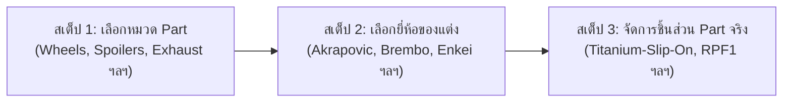

# 🚀 MASTER WORKER PROMPT: Admin Edit Data — Unified Grid Hierarchy & 3-Step Part Selection Flow with Delete Safeguard

> **อ้างอิงรูปภาพและโฟลเดอร์หลัก**:
> - โฟลเดอร์: [`fix list/`](../fix%20list/)
> - รูปแบบ Grid มาตรฐาน: [`fix list/desire_format.png`](../fix%20list/desire_format.png) (Card 1 = Entity หลักเพื่อ Edit, Card 2 = (+), Card 3+ = รายการลูก)
> - หน้า Body Kit เดิม: [`fix list/old_bodykit.png`](../fix%20list/old_bodykit.png)
> - หน้า Part เดิม: [`fix list/old_part.png`](../fix%20list/old_part.png)
> - โครงสร้าง Storage: [`STORAGE_CATALOG_TREE.md`](../../STORAGE_CATALOG_TREE.md)

---

## 📌 บทบาทและเป้าหมายของงาน (Role & Objective)
คุณคือ **Senior Frontend Developer (Angular 22)** ประจำโปรเจกต์ **Performante Lab**
หน้าที่ของคุณคือ ปรับปรุงหน้า **Admin Edit Data (`/admin/edit-data`)** โดยเน้นการจัดโครงสร้าง Grid ตามฟอร์แมตใน `desire_format.png` ให้เหมือนกันทุกระดับ และปรับโฟลว์การเลือก Part ให้เป็น **3 สเต็ป (เลือกหมวด $\rightarrow$ เลือกยี่ห้อ $\rightarrow$ เลือกชิ้นส่วนจริง)** พร้อมระบบ **Delete Confirmation Safeguard** ก่อนลบข้อมูล

---

## 🎯 1. รายละเอียดการแก้ไขในแท็บ Body Kit (`old_bodykit.png`)

### A. โครงสร้าง Grid หน้าเลือกยี่ห้อ BodyKit (ใช้ฟอร์แมตตาม `desire_format.png`)
ในหน้าเลือกยี่ห้อ BodyKit ให้ใช้ Grid ชุดเดียวกัน โดย:
1. **Card 1: Card ยี่ห้อรถ (Car Brand) หรือ รุ่นรถ (Car Model)**:
   - ทำหน้าที่เป็น Card แสดง Entity หลัก พร้อมจุดเขียว Active
   - **เมื่อคลิก**: จะเปิด Modal เพื่อ **แก้ไขข้อมูลยี่ห้อ/รุ่นรถ** ได้ทันที (แก้ไขชื่อ + อัปโหลดรูปใหม่) ตามที่กำหนดใน `desire_format.png`
2. **Card 2: `(+) เพิ่มแบรนด์` (Add Tuning Brand)**:
   - คลิกเพื่อเปิด Modal เพิ่มสำนักแต่ง Body Kit (ใส่ชื่อแบรนด์ + บังคับอัปโหลดรูปโลโก้)
3. **Card 3, 4, ...: Card สำนักแต่ง Body Kit** (เช่น `Liberty-Walk`, `Novitec`, `Sano-Design`):
   - แสดงโลโก้, ชื่อสำนักแต่ง, คำบรรยาย *"คลิกเพื่อดูชิ้นส่วน"*
   - มีปุ่ม **ถังขยะ (Delete)** เล็กๆ ที่มุม Card สำหรับลบสำนักแต่ง (พร้อมเรียก Confirmation Dialog)
   - เมื่อคลิกที่ Card จะนำทางเข้าไปสู่ **หน้ารายการชุดแต่งของสำนักแต่งนั้น (Body Kit Items)**

### B. หน้ารายการชุดแต่งของสำนักแต่งที่เลือก (Body Kit Items)
เมื่อคลิกเข้ามาดูชิ้นส่วนของสำนักแต่ง (เช่น `Liberty-Walk`) ให้ใช้ฟอร์แมต `desire_format.png` เช่นกัน:
- **Card 1: Card สำนักแต่ง (Tuning Brand Card)**: แสดงโลโก้และชื่อสำนักแต่ง เมื่อคลิกสามารถเปิด Modal แก้ไขชื่อ/อัปโหลดโลโก้สำนักแต่งใหม่ได้
- **Card 2: `(+) เพิ่มชิ้นส่วน`**: เพิ่มแบบชุดแต่งใหม่ (ใส่ชื่อ TypeName + อัปโหลดรูป)
- **Card 3+**: รายการชุดแต่งจริง เช่น `LB-Silhouette-Works.png` พร้อมปุ่มลบ

---

## 🚗 2. รายละเอียดการแก้ไขในแท็บ Part (ชิ้นส่วนแต่ง) — โฟลว์ 3 สเต็ป

แทนการแสดงแท็บหมวดหมู่แบบปุ่มเล็กๆ ด้านบนอย่างเดียว ให้ปรับการเลือกในแท็บ Part เป็น **3 สเต็ปตามลำดับ (Hierarchical Flow)** โดยทุกสเต็ปใช้ฟอร์แมต `desire_format.png`:



### สเต็ป 1: หน้าเลือกหมวดหมู่ Part (Select Part Category)
- **Card 1: Entity Card หลัก (Car Model / Brand)**: คลิกเพื่อแก้ไขข้อมูลรถ
- **Card 2: `(+) เพิ่มหมวดหมู่`**: เปิด Modal พิมพ์ชื่อหมวดหมู่ใหม่ เช่น *"ไฟหน้า"*, *"ค้ำโช้ค"*
- **Card 3, 4, ...: หมวดหมู่ Part** (เช่น `Wheels`, `Spoilers`, `Exhaust`, `Brakes`, `Suspension`):
  - แสดงไอคอนหมวดหมู่, ชื่อหมวด, จำนวนยี่ห้อ/ชิ้นส่วนที่มีอยู่
  - มีปุ่ม **ถังขยะ (Delete)** สำหรับลบหมวดหมู่
  - เมื่อคลิกหมวดหมู่ จะเข้าสู่ **สเต็ป 2 (เลือกยี่ห้อ)**

### สเต็ป 2: หน้าเลือกยี่ห้อของแต่งในหมวดนั้น (Select Tuning Brand for Category)
- มี Breadcrumb แสดง: `Part / [ชื่อหมวด เช่น Wheels]` พร้อมปุ่มย้อนกลับไปสเต็ป 1
- **Card 1: Card หมวดหมู่ที่เลือก (Category Card)**: แสดงชื่อหมวดหมู่ที่กำลังดูอยู่
- **Card 2: `(+) เพิ่มแบรนด์`**: เปิด Modal เพิ่มยี่ห้อของแต่งสำหรับหมวดนี้ (ใส่ชื่อ + บังคับอัปโหลดโลโก้)
- **Card 3, 4, ...: ยี่ห้อของแต่งในหมวดนี้** (เช่น `Enkei`, `BBS`, `Akrapovic`):
  - แสดงโลโก้, ชื่อยี่ห้อ, จำนวน Part ในหมวดนี้
  - มีปุ่ม **ถังขยะ (Delete)** สำหรับลบยี่ห้อ
  - เมื่อคลิกยี่ห้อ จะเข้าสู่ **สเต็ป 3 (เลือก part จริง)**

### สเต็ป 3: หน้ารายการชิ้นส่วน Part จริง (Manage Real Part Items)
- มี Breadcrumb แสดง: `Part / [หมวดหมู่] / [ยี่ห้อ]` พร้อมปุ่มย้อนกลับไปสเต็ป 2
- **Card 1: Card ยี่ห้อของแต่ง (Tuning Brand Card)**: คลิกเพื่อแก้ไขชื่อยี่ห้อหรืออัปโหลดโลโก้ใหม่
- **Card 2: `(+) เพิ่มชิ้นส่วน`**: เปิด Modal เพิ่ม Part (ชื่อชิ้นส่วน + อัปโหลดรูปจริง + ระบุราคาถ้ามี)
- **Card 3, 4, ...: รายการ Part จริง** (เช่น `RPF1-Silver-18inch.png`):
  - แสดงรูปชิ้นส่วน, ชื่อชิ้นงาน, ราคา
  - มีปุ่ม **ถังขยะ (Delete)** สำหรับลบชิ้นส่วน

---

## ⚠️ 3. ระบบยืนยันความปลอดภัยก่อนลบ (Delete Confirmation Safeguard)

ตามข้อกำหนด:
> *(ถ้าจะลบ part และหากมี data ยี่ห้อ หรือ part จริง อยู่ใน part นั้นๆ ให้มีปุ่มยืนยันว่าจะลบจริงไหมด้วย)*

ให้สร้าง **Delete Confirmation Modal** สากลสำหรับหน้า Edit Data โดยมีเงื่อนไขดังนี้:

1. **เมื่อกดลบหมวดหมู่ (Delete Category)**:
   - ตรวจสอบว่าหมวดนี้มียี่ห้อหรือชิ้นส่วนอยู่หรือไม่
   - หากมีข้อมูลอยู่: แสดง Modal คำเตือนสีส้ม/แดง:
     > **"ยืนยันการลบหมวดหมู่ [ชื่อหมวด]?"**  
     > *หมวดหมู่นี้มีข้อมูล [N] แบรนด์ และ [M] ชิ้นส่วนอยู่ภายใน การลบจะทำให้ข้อมูลทั้งหมดในหมวดหมู่นี้ถูกลบถาวร คุณแน่ใจหรือไม่?*
     - ปุ่ม: `ยกเลิก` และ `ยืนยันลบข้อมูลทั้งหมด`

2. **เมื่อกดลบยี่ห้อของแต่ง (Delete Tuning Brand)**:
   - ตรวจสอบว่ามียี่ห้อนี้มีชิ้นส่วน Part อยู่ภายในหรือไม่
   - หากมีชิ้นส่วนอยู่: แสดง Modal คำเตือน:
     > **"ยืนยันการลบแบรนด์ [ชื่อแบรนด์]?"**  
     > *แบรนด์นี้มี [M] ชิ้นส่วนอยู่ภายใน คุณต้องการลบแบรนด์และชิ้นส่วนทั้งหมดของแบรนด์นี้หรือไม่?*

3. **เมื่อกดลบชิ้นส่วน Part (Delete Part Item)**:
   - แสดง Modal ยืนยันการลบไฟล์และข้อมูลชิ้นส่วนนั้นออกจากระบบและ Supabase Storage

4. **การลบไฟล์ใน Supabase Storage**:
   - เมื่อยืนยันการลบ ให้เรียก `CatalogStorageHelper` เพื่อลบไฟล์ออกจาก Storage Bucket `catalog` ด้วย เพื่อไม่ให้มีไฟล์ขยะค้างอยู่ใน Bucket

---

## 📂 4. ไฟล์ที่เกี่ยวข้องในการทำงาน
1. `src/app/features/admin/edit-data/admin-edit-data.html`:
   - ปรับ Grid ของทั้ง Body Kit และ Part ให้เริ่มต้นด้วย Card 1 เป็น Entity สำหรับ Edit ตาม `desire_format.png`
   - เพิ่ม Delete Confirmation Modal
2. `src/app/features/admin/edit-data/admin-edit-data.ts`:
   - เพิ่ม State Navigation สำหรับ 3 สเต็ปของ Part (`partStep: 'category' | 'brand' | 'parts'`)
   - เพิ่ม State และฟังก์ชันสำหรับ Delete Confirmation (`confirmDeleteModalOpen`, `itemToDelete`, `executeDelete()`)
3. `src/app/features/admin/services/admin.service.ts`:
   - เพิ่มฟังก์ชัน `deletePartCategory()`, `deleteTuningBrand()`, `deletePartItem()`
4. `src/app/core/storage/catalog-storage.ts`:
   - เพิ่มฟังก์ชัน `deleteFile(client, path)` หรือ `deleteFolder(client, prefix)`

---

## 🧪 5. การทดสอบและส่งมอบ (Verification Checklist)
1. รันการทดสอบ Unit Tests:
   ```bash
   npm test -- --watch=false
   ```
   - ยืนยันว่าทุก Test Files ผ่านทั้งหมด 100%
2. ตรวจสอบ UI ว่าตรงตาม `desire_format.png` ทุกระดับ:
   - Card 1: คลิกแล้วเปิด Modal เพื่อแก้ไขข้อมูลได้เสมอ
   - Card 2: เป็นปุ่ม `(+)` เพื่อเพิ่มข้อมูลในระดับนั้นเสมอ
   - Card 3+: เป็นข้อมูลจริง
3. ทดสอบการลบ:
   - กดลบหมวดหมู่หรือยี่ห้อที่มีข้อมูลลูกอยู่ จะต้องมี Confirmation Modal แสดงแจ้งเตือนอย่างชัดเจน

