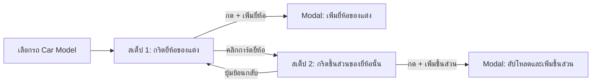

# 🚀 MASTER WORKER PROMPT: Refactor Admin Edit Data (Streamlined Forms & 2-Step Tuning Parts Architecture)
## Feature: ปรับปรุงหน้า Admin Edit Data (ตัดฟิลด์ที่ไม่จำเป็น + แยกหมวด Body Kit/Part + เลือดยี่ห้อของแต่งก่อนเลือกชิ้นส่วน)

---

## 📌 บทบาทและบริบทของงาน (Role & Context)
คุณคือ **Senior Frontend Developer (Angular 22)** ประจำโปรเจกต์ **Performante Lab**
หน้าที่ของคุณคือ ปรับปรุงหน้าจอ **Admin Edit Data (`/admin/edit-data`)** ทั้งในส่วน UI Template (`admin-edit-data.html`) และ Component Logic (`admin-edit-data.ts`) ให้ตรงตามข้อกำหนดใหม่ โดย:
1. **ตัดฟิลด์ที่ไม่จำเป็นใน Modal เพิ่ม Brand และ Car ออก** (บังคับอัปโหลดรูปจริงจากเครื่องเท่านั้น)
2. **ปรับสถาปัตยกรรม Level 3 (ชุดแต่งและพาร์ต)** ให้แยกชัดเจนระหว่าง **Body Kit** กับ **Part (ชิ้นส่วน)**
3. **ระบบแต่งรถ 2 ขั้นตอน (2-Step Tuning Selection)**: เลือก **ยี่ห้อของแต่ง (Tuning Brand)** ก่อน $\rightarrow$ แล้วจึงเข้าไปดู/เพิ่ม **ชิ้นส่วน (Part Items)** ของยี่ห้อนั้น
4. **จัดเก็บรูปภาพลง Supabase Storage** ตามโครงสร้าง Path ใน `STORAGE_CATALOG_TREE.md` อย่างเคร่งครัด

---

## 🎯 1. รายละเอียดการปรับปรุงฟอร์ม Modal (Form Simplification)

### A. Modal เพิ่ม Brand รถ (`openBrandModal`)
- ❌ **เอาออก**: ช่องใส่ Link รูปภาพ (`newBrandLogo` text input)
- ❌ **เอาออก**: Checkbox ปรับพื้นหลังพิเศษ (`newBrandCustomBg` checkbox)
- ✅ **สิ่งที่คงเหลือ**:
  1. ชื่อแบรนด์รถ (`name`) เช่น Toyota, Ferrari, Porsche
  2. กล่องอัปโหลดไฟล์รูปภาพโลโก้จากเครื่อง (รองรับ `.png`, `.jpg`, `.webp`)
  - จัดเก็บเข้า Supabase Storage ที่: `catalog/{CarBrand}/logo.{ext}`

### B. Modal เพิ่ม รุ่น รถ (`openCarModal`)
- ❌ **เอาออก**: ช่องใส่ Link รูปภาพ (`newCarImage` text input)
- ❌ **เอาออก**: ช่องเลือกประเภทตัวถัง (`newCarBodyType` dropdown: Coupe, Sedan ฯลฯ)
- ✅ **สิ่งที่คงเหลือ**:
  1. ชื่อรุ่นรถ (`name`) เช่น 488 Pista, GT86, Civic Type R
  2. กล่องอัปโหลดไฟล์รูปรถต้นแบบจากเครื่อง (รองรับ `.jpg`, `.png`, `.webp`)
  - จัดเก็บเข้า Supabase Storage ที่: `catalog/{CarBrand}/{CarModel}/CarPicture.{ext}`

---

## 🚗 2. สถาปัตยกรรม Level 3: ปรับปรุงการจัดการชุดแต่งและชิ้นส่วน (Body Kit & Parts)

### A. แยกแท็บหลัก: `Body Kit` vs `Part (ชิ้นส่วน)`
- **แท็บ 1: Body Kit (ชุดแต่งรอบคัน)**:
  - จัดการชุดแต่งรอบคันทั้งเซ็ต
  - Path ใน Storage: `catalog/{CarBrand}/{CarModel}/BodyKit/{BodyKitBrand}/{TypeName}.{ext}`
- **แท็บ 2: Part (ชิ้นส่วนแต่งรายชิ้น)**:
  - มีแถบเลือกหมวดหมู่ เช่น **ล้อ (Wheels)**, **สปอยเลอร์ (Spoilers)**, **ท่อไอเสีย (Exhaust)**, **เบรก (Brakes)**, **ช่วงล่าง (Suspension)**
  - **มีปุ่ม `(+) เพิ่มหมวดหมู่ใหม่` (Add Category)**: กรณีที่รถคันนี้ยังไม่มีหมวดหมู่นั้น สามารถพิมพ์เพิ่มหมวดใหม่ได้ทันที (เช่น เพิ่มหมวด 'ล้อ' หรือ 'ไฟหน้า')
  - Path ใน Storage: `catalog/{CarBrand}/{CarModel}/Part/{PartBrand}/{TypeName}.{ext}`

### B. ระบบ 2 ขั้นตอน (2-Step Selection): ยี่ห้อของแต่ง $\rightarrow$ ชิ้นส่วน
ไม่ว่าจะเป็นในแท็บ Body Kit หรือ Part การแสดงผลและการเลือกจะแบ่งเป็น 2 สเต็ป:



#### สเต็ปที่ 1: หน้ารวมยี่ห้อของแต่ง (Tuning Brands Grid)
- แสดงการ์ดยี่ห้อของแต่งที่มีอยู่ในระบบสำหรับรถรุ่นนี้:
  - เช่น สำหรับ Body Kit: `Sano Design`, `Liberty Walk`, `Novitec`, `Rocket Bunny`
  - เช่น สำหรับ Part: `Brembo`, `Enkei`, `Tomei`, `KW Suspension`, `Voltex`
- **การ์ดใบแรก**: ปุ่ม `(+) เพิ่มแบรนด์ของแต่ง` (เปิด Modal ให้พิมพ์ชื่อยี่ห้อ เช่น "Akrapovic", "BBS")
- เมื่อคลิกการ์ดยี่ห้อใด $\rightarrow$ สลับมุมมองเข้าสู่ **สเต็ปที่ 2**

#### สเต็ปที่ 2: หน้ารายการชิ้นส่วนของยี่ห้อนั้น (Brand's Part Items Grid)
- มีแถบด้านบนระบุ: `[แบรนด์ของแต่งที่เลือก]` พร้อมปุ่มย้อนกลับไปเลือกยี่ห้อ
- แสดงการ์ดชิ้นส่วน/แบบชุดแต่งของยี่ห้อนั้น:
  - เช่น ภายใต้ Sano Design: แสดง `Track Edition Concept`, `Street Aero Concept`
  - เช่น ภายใต้ Enkei: แสดง `RPF1 Silver 18-inch`, `NT03RR`
- **การ์ดใบแรก**: ปุ่ม `(+) เพิ่มชิ้นส่วนใหม่`:
  - ฟอร์ม Modal:
    1. ชื่อชิ้นส่วน/แบบแต่ง (`TypeName`)
    2. กล่องอัปโหลดรูปภาพชิ้นส่วนจากเครื่องจริง (รองรับ `.png`, `.jpg`, `.webp`)
    3. ราคาประเมินอ้างอิง (ถ้ามี)
  - อัปโหลดรูปเข้า Storage ตาม Path:
    - ถ้าเป็น Body Kit: `catalog/{CarBrand}/{CarModel}/BodyKit/{BodyKitBrand}/{TypeName}.{ext}`
    - ถ้าเป็น Part: `catalog/{CarBrand}/{CarModel}/Part/{PartBrand}/{TypeName}.{ext}`
  - บันทึกลงตาราง `car_parts` ใน Supabase ทันที

---

## 📂 3. ไฟล์และโค้ดที่ต้องแก้ไข (Files to Update)

### ─── 1. `src/app/features/admin/edit-data/admin-edit-data.ts` ───

1. **ปรับ State และ Signals**:
   ```typescript
   // View navigation สำหรับ Level 3
   readonly partTab = signal<'bodykit' | 'parts'>('bodykit'); // สลับระหว่าง Body Kit หรือ Part
   readonly selectedCategory = signal<string>('Wheels'); // หมวดหมู่ย่อยของ Part (ล้อ, สปอยเลอร์ ฯลฯ)
   readonly availableCategories = signal<string[]>([
     'Wheels',
     'Spoilers',
     'Exhaust',
     'Brakes',
     'Suspension',
   ]);

   // สเต็ปการเลือกของแต่ง: null = สเต็ป 1 (เลือกยี่ห้อ), string = สเต็ป 2 (เลือกชิ้นส่วนของยี่ห้อนั้น)
   readonly selectedTuningBrand = signal<string | null>(null);

   // Modal states ใหม่
   readonly tuningBrandModalOpen = signal(false); // Modal เพิ่มยี่ห้อของแต่ง
   readonly newTuningBrandName = signal('');
   readonly newCustomCategoryName = signal(''); // สำหรับเพิ่มหมวดหมู่พาร์ตใหม่
   readonly categoryModalOpen = signal(false);
   ```

2. **Computed สำหรับดึงรายชื่อแบรนด์ของแต่ง (สเต็ป 1)**:
   ```typescript
   // ดึงรายชื่อยี่ห้อของแต่งที่ไม่ซ้ำกันสำหรับรถคันนี้
   readonly tuningBrandsForCurrentContext = computed(() => {
     const car = this.selectedCar();
     if (!car) return [];
     const isBodyKit = this.partTab() === 'bodykit';
     const cat = this.selectedCategory();

     const relevantParts = this.admin.catalogParts().filter((p) => {
       const isMatchCar = (p.car_model_id || p.carId) === car.id;
       if (!isMatchCar) return false;
       return isBodyKit ? p.category === 'BodyKit' : p.category === cat;
     });

     const brands = Array.from(new Set(relevantParts.map((p) => p.manufacturer || 'Custom')));
     return brands;
   });
   ```

3. **Computed สำหรับดึงรายการชิ้นส่วนของยี่ห้อที่เลือก (สเต็ป 2)**:
   ```typescript
   readonly partsForSelectedTuningBrand = computed(() => {
     const car = this.selectedCar();
     const brandName = this.selectedTuningBrand();
     if (!car || !brandName) return [];
     const isBodyKit = this.partTab() === 'bodykit';
     const cat = this.selectedCategory();

     return this.admin.catalogParts().filter((p) => {
       const isMatchCar = (p.car_model_id || p.carId) === car.id;
       const isMatchBrand = (p.manufacturer || 'Custom').toLowerCase() === brandName.toLowerCase();
       const isMatchCategory = isBodyKit ? p.category === 'BodyKit' : p.category === cat;
       return isMatchCar && isMatchBrand && isMatchCategory;
     });
   });
   ```

4. **ฟังก์ชันจัดการการเพิ่มและอัปโหลด**:
   - `addCustomCategory()`: เพิ่มหมวดหมู่ใหม่เข้า `availableCategories`
   - `addTuningBrand()`: เพิ่มยี่ห้อของแต่งใหม่และตั้งเป็น `selectedTuningBrand` ทันที
   - `savePart()`: อัปโหลดรูปภาพตามโครงสร้าง Path และบันทึกลงตาราง `car_parts`

---

### ─── 2. `src/app/features/admin/edit-data/admin-edit-data.html` ───

1. **ปรับปรุง Modal เพิ่ม Brand รถ**:
   - ลบ `input [ngModel]="newBrandLogo()"`
   - ลบ `checkbox [ngModel]="newBrandCustomBg()"`
   - เหลือเฉพาะ: ช่องกรอกชื่อแบรนด์ และ Dropzone อัปโหลดไฟล์รูปภาพ

2. **ปรับปรุง Modal เพิ่มรุ่นรถ (Car Model)**:
   - ลบ `input [ngModel]="newCarImage()"`
   - ลบ `select [ngModel]="newCarBodyType()"`
   - เหลือเฉพาะ: ช่องกรอกชื่อรุ่นรถ และ Dropzone อัปโหลดไฟล์รูปภาพ

3. **ปรับปรุง Level 3 (ชุดแต่งและพาร์ต)**:
   - **ส่วนสลับแท็บหลัก**:
     - ปุ่ม `[Body Kit]` และปุ่ม `[Part ชิ้นส่วนแต่ง]`
   - **กรณีเลือกแท็บ Part**:
     - แสดงแท็บหมวดหมู่ (ล้อ, สปอยเลอร์, ท่อ ฯลฯ) พร้อมปุ่ม `+ เพิ่มหมวดหมู่ใหม่`
   - **เมื่อ `selectedTuningBrand() === null` (สเต็ป 1: เลือกยี่ห้อ)**:
     - แสดงกริดยี่ห้อของแต่ง
     - การ์ดใบแรกเป็นปุ่ม `(+) เพิ่มแบรนด์ของแต่ง`
     - คลิกยี่ห้อใด $\rightarrow$ `selectedTuningBrand.set(brand)`
   - **เมื่อ `selectedTuningBrand() !== null` (สเต็ป 2: แสดงชิ้นส่วนของยี่ห้อนั้น)**:
     - แสดงหัวข้อ: *"ชิ้นส่วนของแบรนด์: {{ selectedTuningBrand() }}"* พร้อมปุ่ม `ย้อนกลับ`
     - แสดงกริดชิ้นส่วนของแบรนด์นั้น
     - การ์ดใบแรกเป็นปุ่ม `(+) เพิ่มชิ้นส่วนใหม่`

---

### ─── 3. `src/app/core/storage/catalog-storage.ts` ───
ตรวจสอบให้แน่ใจว่าฟังก์ชันสร้าง Path สอดคล้องกับ `STORAGE_CATALOG_TREE.md`:
```typescript
static getBodyKitPath(
  brand: string,
  model: string,
  bodyKitBrand: string,
  typeName: string,
  ext = 'png',
): string {
  return `${this.sanitize(brand)}/${this.sanitize(model)}/BodyKit/${this.sanitize(bodyKitBrand)}/${this.sanitize(typeName)}.${ext}`;
}

static getPartPath(
  brand: string,
  model: string,
  partBrand: string,
  typeName: string,
  ext = 'png',
): string {
  return `${this.sanitize(brand)}/${this.sanitize(model)}/Part/${this.sanitize(partBrand)}/${this.sanitize(typeName)}.${ext}`;
}
```

---

## 🧪 4. Testing & Verification Checklist
1. **ทดสอบ Modal เพิ่ม Brand**:
   - เปิด Modal ตรวจสอบว่าไม่มีช่องใส่ URL และไม่มี Checkbox
   - กรอกชื่อแบรนด์และอัปโหลดไฟล์ $\rightarrow$ ตรวจสอบว่ารูปถูกเซฟที่ `catalog/{Brand}/logo.{ext}` และแสดงผลได้ถูกต้อง
2. **ทดสอบ Modal เพิ่มรุ่นรถ**:
   - เปิด Modal ตรวจสอบว่าไม่มีช่องใส่ URL และไม่มี Body type dropdown
   - กรอกชื่อรุ่นและอัปโหลดรูป $\rightarrow$ ตรวจสอบว่ารูปถูกเซฟที่ `catalog/{Brand}/{Model}/CarPicture.{ext}`
3. **ทดสอบสเต็ป 1 และ 2 ของ Body Kit และ Part**:
   - สลับแท็บ Body Kit $\rightarrow$ แสดงยี่ห้อชุดแต่ง $\rightarrow$ คลิกเลือกยี่ห้อ $\rightarrow$ แสดงรายการชุดแต่งของยี่ห้อนั้น
   - สลับแท็บ Part $\rightarrow$ ทดลองกด `+ เพิ่มหมวดหมู่` (เช่น เพิ่มหมวด "ล้อ") $\rightarrow$ หมวดใหม่แสดงผลทันที
   - กด `+ เพิ่มแบรนด์ของแต่ง` (เช่น "Enkei") $\rightarrow$ คลิกเลือก Enkei $\rightarrow$ กด `+ เพิ่มชิ้นส่วน` อัปโหลดรูป $\rightarrow$ ตรวจสอบว่ารูปถูกเซฟที่ `catalog/{Brand}/{Model}/Part/Enkei/...`
4. **คำสั่งตรวจสอบคุณภาพ**:
   ```bash
   cd Performante_Lab_Frontend
   npm test -- --watch=false
   npm run build
   ```
   *(ต้องผ่านครบทุก Test Suites และไม่มี Build Error)*

---

## 📋 Definition of Done
- [ ] ใน Modal เพิ่ม Brand ไม่มีช่องใส่ Link และไม่มี Checkbox
- [ ] ใน Modal เพิ่มรุ่นรถ ไม่มีช่องใส่ Link และไม่มีช่องเลือก Body type
- [ ] Level 3 แยกหมวด Body Kit และ Part อย่างชัดเจน
- [ ] สามารถกดเพิ่มหมวดหมู่ชิ้นส่วนใหม่ใน Part ได้อย่างอิสระ
- [ ] มี Flow การเลือก 2 สเต็ป: เลือดยี่ห้อของแต่งก่อน $\rightarrow$ แล้วจึงเข้าไปดู/เพิ่มชิ้นส่วนของยี่ห้อนั้น
- [ ] การอัปโหลดรูปภาพลง Storage เป็นไปตาม Path ใน `STORAGE_CATALOG_TREE.md` อย่างสมบูรณ์
- [ ] `npm test` และ `npm run build` ผ่าน 100%

